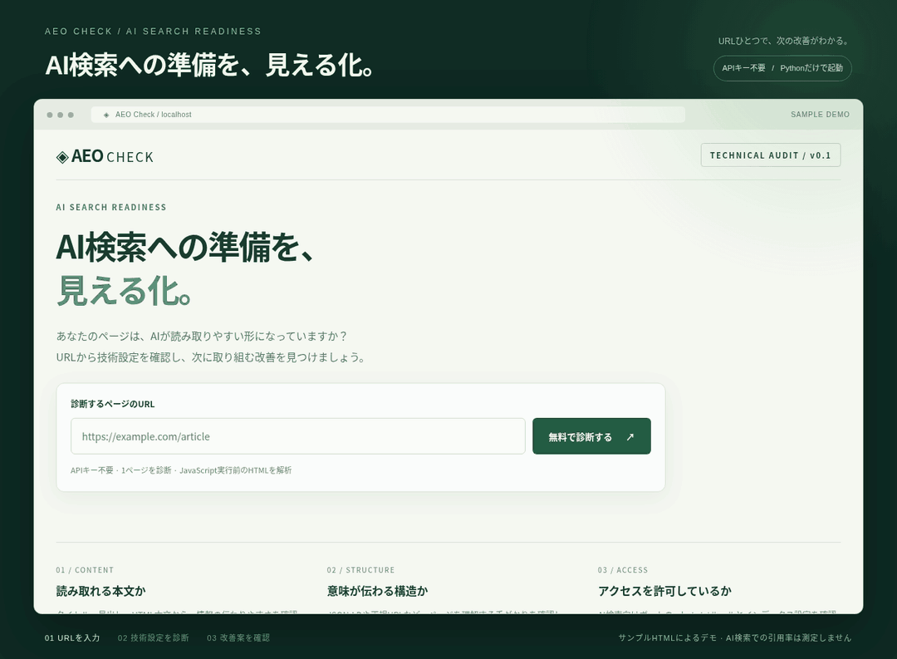

# AEO Check



<p align="center"><sub>サンプルHTMLを使用した操作デモ。実際のアプリ画面と診断ロジックで生成しています。</sub></p>

URLから、AI検索に向けたページの技術設定を診断するMVP。Python 3.12以上の標準ライブラリだけで動作します。APIキー不要。

```bash
python3 app.py
# http://127.0.0.1:8000
```

## 診断内容

- title、meta description、H1、H2、本文の取得可否
- JSON-LDの構文・Schema.orgのcontext・型の指定（@graph・配列にも対応）、canonical、html lang
- meta robots / X-Robots-Tagのnoindex
- robots.txtによるOAI-SearchBot / ChatGPT-User / PerplexityBot / Googlebot / GPTBotの指定URLへのアクセス可否
- 優先順位つき改善案、適用場所つきの修正例とコピーボタン、JSON・Markdownレポートの保存、印刷用レイアウトからのPDF保存
- ブラウザ内の診断履歴（直近10件）、同じURLの前回結果との比較

スコアは9項目の独自の重みづけ合計（100点）。本文・構造化データ・インデックス設定は各15点、言語は5点、その他は各10点。ボットの許可設定はスコアに含みません。GPTBotは学習用として区別します。

**AI検索での引用率・実際の掲載状況を測定、保証するものではありません。** JavaScriptは実行しません。本文にはナビゲーション等が含まれ得ます。JSON-LDは型名の実在や必須プロパティ、リッチリザルト適合まで検証しません。robots.txtの取得失敗は不明として表示し、404/410はルールなしとして扱います。robots.txtは技術的なアクセス許可やHTTPステータスを保証しません。

## 構造化データの基本確認

JSON-LDごとに検出した型と問題点を表示します。Schema.orgのcontext（HTTP/HTTPS）、インラインの `@vocab`・名前空間prefix、絶対URL形式の型、型の配列、`@graph`、入れ子のcontextの継承・リセットに対応します。JSON構文エラー、型の未検出、不正な型指定やgraphの形式を要確認として表示します。NaNなど標準JSONでない値も通過させません。

構造化データの項目は、JSON-LDを1つ以上検出し、すべてのブロックが基本確認を通過した場合だけ加点します。1つに問題があっても他のブロックの検出結果は表示します。独自・外部contextは取得・展開しないため、「要確認」は必ずしもJSON-LDが不正という意味ではありません。型名の実在・必須項目・リッチリザルト適合は公式検証ツールで確認してください。解析はブロックごとに深さ60・要素2000を上限とし、超過時は手動確認を案内します。

判定基準バージョンは `2` です。以前の履歴も表示できますが、判定基準が違う結果とのスコア比較は行いません。APIには `analysis_version` と `schema_details`（ブロック番号・型・問題点・基本確認の通過状態）を含め、Markdownと印刷レポートにも詳細を表示します。

## レポートの共有

診断結果の「Markdown ↓」で、診断日時・スコア・前回比較・優先順位つき改善案・修正コード・技術チェック・クローラー設定を `.md` ファイルに保存できます。「JSON ↓」では元の診断結果を保存します。

「印刷 / PDF」からブラウザの印刷画面を開き、保存先に「PDFに保存」を選択してください。印刷時は修正例をすべて展開し、フォームや履歴・操作ボタンを非表示にします。印刷終了後は修正例の開閉状態を元に戻します。保存済みの履歴から出力する場合は元の診断日時を表示します。

Markdownと印刷レポートには、他のURLの履歴と本文の抜粋を含めません。対象ページのURL・診断上の検出内容・修正例は含みます。ブラウザによって印刷時の改ページは異なります。

## 履歴と前回比較

成功した診断は、URL・日時・診断結果・本文の抜粋を含めてブラウザのlocalStorageに直近10件保存します。「結果を見る」は保存結果を表示し、「再診断」はページを取得し直します。履歴はサーバーに送信せず、同じブラウザ・同じオリジンだけで利用できます。「履歴をすべて削除」で消去できます。保存できない環境ではタブ内だけで保持し、その旨を表示します。診断に失敗した場合は保存しません。

同じ取得後URLの直前の履歴と、スコア差・通過に変わった項目・要対応に変わった項目を比較します。URLのフラグメントは無視し、クエリは区別します。判定基準・診断項目・配点のいずれかが異なる場合は比較しません。技術チェックの変化を示す機能で、AI検索の評価の変化を測るものではありません。

## 修正例の使い方

診断結果の「修正例と適用方法を見る」を開くと、HTMLの適用場所、確認事項、コピー可能なコードが表示されます。title・descriptionなどの【】内は実際の内容に置き換えてください。構造化データは取得したタイトルとURLを使った汎用WebPageのひな形です。canonicalは取得後のURLを候補にするため、クエリを含め正規URLを確認してください。

例はサイトへ自動適用しません。既存タグとの重複を避けて統合してください。noindexは公開意図やHTTPヘッダーの確認が必要なため、コピー用コードを表示せず手動の確認手順を案内します。クリップボードへの書き込みが拒否された場合は、コードを選択して手動コピーを案内します。

## API

```bash
curl -X POST http://127.0.0.1:8000/api/audit \
  -H 'Content-Type: application/json' \
  -d '{"url":"https://example.com"}'
```

未通過のチェックには `repair`（`location`・`code`・`note`）を含みます。手動確認だけの項目では `code` は `null` です。通過したチェックには `repair` を含みません。

HTTP/HTTPSの標準ポートのみ対応。公開IPのみ許可し、各リダイレクト先も再検証します。検証済みIPへ接続を固定し、HTTPSの証明書は元のホスト名で検証します。レスポンス上限2MB、最大5回の転送、接続タイムアウト8秒。DNSの待ち時間はOSに依存します。直接接続のため、HTTPプロキシ必須の環境では取得できません。

## テスト

```bash
python3 -m unittest discover -s tests -v
node --check static/app.js
node --test tests/history.test.cjs tests/report.test.cjs
```

## 運用範囲

ローカル利用向けの開発サーバーです。履歴はブラウザ内だけに保存します。サーバー上の履歴保存・アカウント同期・認証・課金・定期実行は含みません。インターネットへ公開する際は、リバースプロキシ、認証、レート制限、リクエストの同時実行制限を追加してください。Google Fontsを使用し、読み込めない場合はシステムフォントへ切り替わります。

## READMEデモの再生成

開発用に `playwright` と `pillow` をインストールし、Chromiumが `/usr/bin/chromium` にある環境で実行します。アプリ本体にはこれらの依存は不要です。

```bash
python3 tools/create_hero.py
```

実際のUIを操作し、固定のサンプルHTMLを診断した結果から `docs/hero.gif` を生成します。外部サイトへのアクセスは行いません。

履歴のブラウザ検証（同じ開発用依存を使用）：

```bash
python3 tests/browser_history.py
```

レポートのブラウザ検証（同じ開発用依存と `pdftotext` を使用）：

```bash
python3 tests/browser_report.py
```
